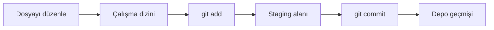

> **Gezinme:** [Önceki: Bölüm 04](04-ilk-depoyu-olusturma.md) | [Yol Haritası](../../ROADMAP.md) | Sonraki: Bölüm 06 yakında
>
> **Seviye:** Başlangıç · **Tahmini Süre:** 70 dakika · **Önkoşullar:** [Bölüm 04: İlk Deponuzu Oluşturma](04-ilk-depoyu-olusturma.md)

## Öğrenme Hedefleri

- çalışma dizini, staging alanı ve depo arasındaki akışı açıklamak;
- `git add` ile değişiklikleri commit için hazırlamak;
- `git commit` ile kalıcı geçmiş noktası oluşturmak;
- `git log` ve `git show` ile commitleri incelemek;
- küçük ve anlaşılır commitler yazmak.

## Giriş

Commit, seçilmiş değişikliklerin kaydedilmiş bir anlık görüntüsüdür. Git editördeki her hareketi otomatik olarak geçmişe kaydetmez; bir sonraki geçmiş noktasına hangi değişikliklerin gireceğine siz karar verirsiniz.

## Görsel Öğrenme



_Şekil 1. Değişiklikler çalışma dizininden geçmişe bilinçli olarak taşınır._

## Neden Önemli?

İyi commitler geliştirme sürecini anlaşılır kılar. İyi bir commit “Ne değişti ve neden?” sorusunu cevaplar. Küçük commitler incelemeyi, geri almayı ve pull request içinde açıklamayı kolaylaştırır.

## Temel Kavramlar

| Kavram        | Açıklama                                              |
| ------------- | ----------------------------------------------------- |
| Commit        | Seçilmiş değişikliklerin kaydedildiği geçmiş noktası. |
| Staging alanı | Bir sonraki commit için hazırlanan alan.              |
| Commit mesajı | Değişikliği kısa biçimde açıklayan mesaj.             |
| Geçmiş        | Depodaki commitlerin sıralı yapısı.                   |
| Diff          | İki durum arasındaki fark.                            |

## Kuram

### Değişikliği commit etmek

```bash
echo "# Release Notes" > README.md
git add README.md
git commit -m "Add release notes README"
git log --oneline
```

`git add` geçmişi değiştirmez. Sadece seçilen dosyayı staging alanına alır. `git commit` ise hazırlanan durumu kaydeder.

### Değişiklikleri incelemek

```bash
git status
git diff
git diff --staged
git show --stat --oneline HEAD
```

`git diff` hazırlanmamış değişiklikleri, `git diff --staged` ise bir sonraki committe yer alacak değişiklikleri gösterir.

### İyi commit mesajları

Mesaj bir eylemle başlamalı ve küçük bir değişikliği anlatmalıdır: `Add installation guide` veya `Fix broken link`. `Update` gibi belirsiz mesajlar geçmişin değerini azaltır.

## Uygulamalı Örnekler

### Örnek 1: İki ayrı commit

```bash
git add README.md
git commit -m "Add project overview"
git add CONTRIBUTING.md
git commit -m "Add contribution guidance"
```

İlişkisiz değişiklikler ayrı ve kolay incelenebilir kalır.

### Örnek 2: Hazırlanmış değişikliği geri almak

```bash
git reset README.md
git status
```

Bu komut dosyayı silmeden staging alanından çıkarır.

## En İyi Uygulamalar

- `git add` öncesinde diff'i inceleyin.
- Bir commit'i tek bir konuya odaklayın.
- Tutarlı ve açıklayıcı mesajlar kullanın.
- Committen sonra geçmişi kontrol edin.

## Yaygın Hatalar

- büyük klasörde kontrol etmeden `git add .` çalıştırmak;
- bağımsız konuları tek committe birleştirmek;
- anlamsız commit mesajları yazmak;
- `git add` komutunun commit oluşturduğunu sanmak.

## Alıştırmalar ve Çözümler

İki bağımsız dosya değiştirin. Her değişiklik için staging diff'ini inceleyin ve iki odaklı commit oluşturun.

**Çözüm:** Bağımsız konular ayrı commitlere ayrılmalıdır. Commit öncesinde staging diff yalnızca seçilen değişikliği içermelidir.

## Özet

Commit akışı `git add` ve `git commit` komutlarının bilinçli kullanımına dayanır. Staging alanı seçim yapmanızı sağlar. `git log`, `git diff` ve `git show` geçmişi incelemek için kullanılır.

## Sonraki Bölüm

Bölüm 06, paralel geliştirme için branchleri ve branch stratejilerini açıklar.

### İlgili İçerik

- Alıştırma: [Odaklı Commitler Oluşturma](../../exercises/tr/05-odakli-commitler-olusturma.md)
- Laboratuvar: [Odaklı Commitler Oluşturma](../../labs/tr/05-odakli-commitler-olusturma.md)
- Quiz: [Commit Quiz'i](../../quizzes/tr/05-commit-quiz.md)
