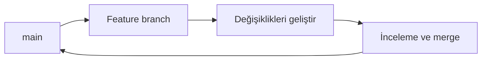

> **Gezinme:** [Önceki: Bölüm 05](05-commitlerle-calisma.md) | [Yol Haritası](../../ROADMAP.md) | Sonraki: Bölüm 07 yakında
>
> **Seviye:** Başlangıç · **Tahmini Süre:** 70 dakika · **Önkoşullar:** [Bölüm 05: Commitlerle Çalışma](05-commitlerle-calisma.md)

## Öğrenme Hedefleri

- branchlerin paralel çalışmayı nasıl mümkün kıldığını açıklamak;
- `git switch` ile branch oluşturmak ve değiştirmek;
- branchleri anlamlı adlandırmak ve güncel tutmak;
- main, feature ve kısa ömürlü branchleri ayırt etmek;
- merge sonrasında branchleri güvenli biçimde silmek.

## Giriş

Branch, bir commit'i gösteren hareketli bir isimdir. Kararlı durumu doğrudan değiştirmeden yeni bir özellik üzerinde çalışmanıza izin verir. Branchler teknik olarak hafiftir; ancak adları ve yaşam süreleri ekip çalışmasını etkiler.

## Görsel Öğrenme



_Şekil 1. Feature branch, çalışmayı birleştirilene kadar izole eder._

## Neden Önemli?

Paralel geliştirme ekiplerde kaçınılmazdır. Branchler tamamlanmamış çalışmanın kararlı branch'e doğrudan gitmesini önler. Başlangıçta basit ve anlaşılır bir strateji, karmaşık modellerden daha değerlidir.

## Temel Kavramlar

| Kavram         | Açıklama                                                |
| -------------- | ------------------------------------------------------- |
| Branch         | Bir commit'i gösteren adlandırılmış hareketli işaretçi. |
| `main`         | Kararlı varsayılan branch için sık kullanılan ad.       |
| Feature branch | Tek bir değişiklik için kullanılan kısa ömürlü branch.  |
| Upstream       | Branchin temel aldığı branch.                           |
| Merge          | Branchleri birleştirme işlemi.                          |

## Kuram

### Branch oluşturmak ve değiştirmek

```bash
git switch main
git switch -c feature/update-readme
git status
git branch --show-current
```

`git switch -c` branchi oluşturur ve hemen ona geçer. Branch adı yapılan işi açıklamalıdır.

### Branchleri görmek

```bash
git branch
git log --oneline --decorate --graph --all
```

Grafik geçmiş, branchlerin birbirleriyle ilişkisini gösterir.

### Branchi tamamlamak

```bash
git switch main
git merge feature/update-readme
git branch -d feature/update-readme
```

Branchi yalnızca değişiklikleri birleştirildikten veya bilinçli biçimde bırakıldıktan sonra silin.

## Uygulamalı Örnekler

### Örnek 1: Dokümantasyon değişikliğini izole etmek

```bash
git switch -c docs/improve-installation
# Dosyaları düzenle
git add .
git commit -m "Improve installation guidance"
```

### Örnek 2: Branch adlarını karşılaştırmak

İyi: `feature/add-search`, `fix/broken-link`, `docs/update-guide`.

Kötü: `test`, `work`, `branch2`; çünkü amaç anlaşılmaz.

## En İyi Uygulamalar

- Her ilişkili değişiklik için bir branch kullanın.
- Kısa ömürlü branchleri düzenli olarak birleştirin.
- Branch değiştirmeden önce çalışma durumunu kontrol edin.
- Ekipçe belirlenmiş adlandırma kuralını kullanın.

## Yaygın Hatalar

- tamamlanmamış işi doğrudan `main` üzerinde geliştirmek;
- hangi branchte olduğunuzu unutmak;
- bağımsız konuları aynı branchte toplamak;
- birleştirilmemiş branchi silmek.

## Alıştırmalar ve Çözümler

Bir feature branch oluşturun, küçük bir değişiklik commit edin ve branch geçmişini gösterin.

**Çözüm:** Feature branch çalışmayı `main`den ayırır. İncelemeden sonra merge edilir ve tamamlanan branch silinebilir.

## Özet

Branchler paralel çalışmayı izole eder. `git switch -c` branch oluşturur, `git branch` branchleri gösterir ve `git merge` değişiklikleri birleştirir. Anlamlı adlar ve kısa yaşam süreleri iş akışını kolaylaştırır.

## Sonraki Bölüm

Bölüm 07, merge işlemlerini ve merge çatışmalarını ele alır.

### İlgili İçerik

- Alıştırma: [Feature Branch Oluşturma](../../exercises/tr/06-feature-branch-olusturma.md)
- Laboratuvar: [Branch Oluşturma ve İnceleme](../../labs/tr/06-branch-olusturma-ve-inceleme.md)
- Quiz: [Dallanma Quiz'i](../../quizzes/tr/06-dallanma-quiz.md)
