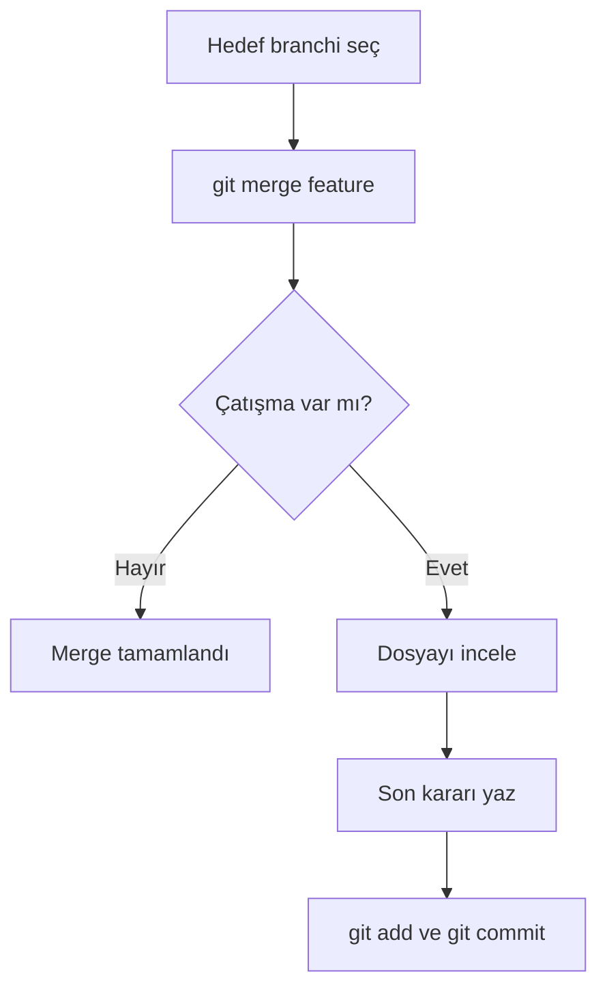

> **Gezinme:** [Önceki: Bölüm 06](06-dallanma-stratejileri.md) | [Yol Haritası](../../ROADMAP.md) | Sonraki: Bölüm 08 yakında
>
> **Seviye:** Başlangıç · **Tahmini Süre:** 75 dakika · **Önkoşullar:** [Bölüm 06: Dallanma Stratejileri](06-dallanma-stratejileri.md)

## Öğrenme Hedefleri

- bir branchi güvenli biçimde merge etmek;
- fast-forward merge işlemini tanımak;
- çatışma işaretlerini okumak ve düzenlemek;
- `git add` ve `git commit` ile çatışmayı tamamlamak;
- gerektiğinde `git merge --abort` ile merge işlemini iptal etmek.

## Giriş

Merge, iki branchin geçmişini birleştirir. Git aynı satırdaki bağımsız değişiklikleri otomatik olarak birleştiremiyorsa çatışma oluşur. Çatışma depo bozulması değil, insanın karar vermesi gereken bir durumdur.

## Görsel Öğrenme



_Şekil 1. Çatışma inceleme ve bilinçli bir commit ile çözülür._

## Neden Önemli?

Çatışmalar ekip çalışmasında normaldir. Akışı bilen bir geliştirici panik yapmaz. Önemli olan ortak amacı anlamak ve diğer değişikliği körü körüne silmemektir.

## Temel Kavramlar

| Kavram          | Açıklama                                                    |
| --------------- | ----------------------------------------------------------- |
| Merge           | İki geliştirme akışını birleştirme.                         |
| Fast-forward    | Yeni bir birleşim commit'i gerektirmeyen merge.             |
| Çatışma         | Git'in rakip değişiklik arasında otomatik karar verememesi. |
| Çatışma işareti | Rakip sürümleri gösteren metin.                             |
| Merge commit    | Birleşen geçmişleri bağlayan commit.                        |

## Kuram

### Merge hazırlığı

```bash
git switch main
git status
git merge feature/update-readme
```

Merge işlemini doğru hedef branchte ve temiz çalışma diziniyle başlatın.

### Çatışma işaretlerini okumak

```text
<<<<<<< HEAD
Mevcut branch sürümü
=======
Birleştirilen branch sürümü
>>>>>>> feature/update-readme
```

İşaretleri kaldırın ve doğru son sürümü yazın. Dosyanın hem sözdizimini hem anlamını kontrol edin.

### Çatışmayı tamamlamak

```bash
git add conflict-file.md
git status
git commit -m "Resolve merge conflict"
```

### Merge işlemini iptal etmek

```bash
git merge --abort
```

Durum belirsizse `--abort` merge öncesindeki duruma dönmenizi sağlar.

## Uygulamalı Örnekler

### Örnek 1: Çatışmayı kontrollü çözmek

1. İki sürümü de okuyun.
2. Değişikliklerin amacını anlayın.
3. Ortak son sürümü yazın.
4. Tüm işaretleri kaldırın.
5. Dosyayı kontrol edin.
6. Stage edip çözümü commit edin.

### Örnek 2: Körlemesine çözmemek

Hangi bilginin doğru olduğunu bilmiyorsanız durun ve sorumlu kişilerle konuşun. Teknik olarak tamamlanan bir merge, iş açısından yine de yanlış olabilir.

## En İyi Uygulamalar

- Merge öncesinde branch ve durumu kontrol edin.
- Düzenli entegrasyonla çatışma boyutunu küçük tutun.
- Çözüm sonrasında diff ve testleri çalıştırın.
- Belirsizlikte merge işlemini iptal edin.

## Yaygın Hatalar

- çatışma işaretlerini committe bırakmak;
- sürümlerden birini körlemesine seçmek;
- yanlış branchte merge yapmak;
- çözüm sonrasında test çalıştırmamak.

## Alıştırmalar ve Çözümler

İki branchte aynı satırı değiştirin, merge edin, çatışmayı çözün ve diff'i inceleyin.

**Çözüm:** İşaretler kontrollü bir ortak sürümle değiştirilir; sonra dosya `git add` ile hazırlanır ve merge commit'i oluşturulur.

## Özet

Merge branchleri birleştirir. Çatışma, Git'in rakip değişiklik arasında karar veremediği zaman oluşur. Güvenli akış: incele, karar ver, işaretleri kaldır, test et, stage et ve commit et.

## Sonraki Bölüm

Bölüm 08, Git'in iç nesnelerini, referanslarını ve yönetim bilgilerini inceler.

### İlgili İçerik

- Alıştırma: [Merge Çatışmasını Çözme](../../exercises/tr/07-merge-catismasini-cozme.md)
- Laboratuvar: [Merge Çatışmasını Çözme](../../labs/tr/07-merge-catismasini-cozme.md)
- Quiz: [Merge ve Çatışmalar Quiz'i](../../quizzes/tr/07-merge-ve-catismalar-quiz.md)
