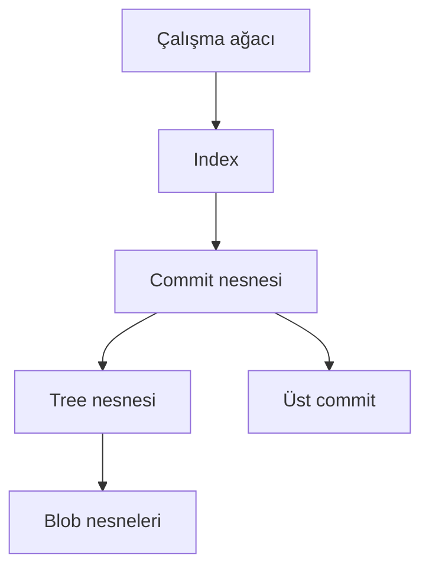

> **Gezinme:** [Önceki: Bölüm 07](07-merge-ve-merge-catismalari.md) | [Yol Haritası](../../ROADMAP.md) | Sonraki: Bölüm 09 yakında
>
> **Seviye:** Orta · **Tahmini Süre:** 75 dakika · **Önkoşullar:** [Bölüm 07: Merge ve Merge Çatışmaları](07-merge-ve-merge-catismalari.md)

## Öğrenme Hedefleri

- Git nesne modelini açıklamak;
- blob, tree, commit ve ref kavramlarını ayırt etmek;
- `.git` klasörünün amacını ve branch işaretçilerinin çalışmasını açıklamak;
- plumbing komutlarıyla depo nesnelerini incelemek;
- Git'in geçmiş içeriği neden güvenilir biçimde kurtarabildiğini anlamak.

## Giriş

`git add`, `git commit` ve `git merge` kullanıcıya görünen katmandır. Altında Git; içerikleri nesne olarak, bunları da referanslarla birbirine bağlı bir yapı olarak saklar. Bu yüzden Git yalnızca bir dosya takip aracı değil, içerik adreslenebilir bir veritabanıdır.

## Görsel Öğrenme



_Şekil 1. Git çalışma ağacını, index'i ve commit nesnelerini birbirine bağlar._

## Temel Kavramlar

| Kavram   | Açıklama                                                      |
| -------- | ------------------------------------------------------------- |
| Blob     | Dosyanın içeriğini saklayan nesne.                            |
| Tree     | Dizinleri ve dosya adlarını nesnelere bağlayan nesne.         |
| Commit   | Snapshot, üst commit ve yazar bilgilerini içeren nesne.       |
| Ref      | Bir commiti gösteren adlandırılmış referans.                  |
| Index    | Bir sonraki commit için staging alanı.                        |
| Plumbing | Git veri yapısını doğrudan inceleyen düşük seviyeli komutlar. |

## Kuram

Git dosyaları yalnızca adlarıyla saklamaz. Blob içerik taşır, tree klasör yapısını açıklar, commit tree ve üst commitlere referans verir. Branch ise commiti gösteren bir ref'tir.

```bash
ls -la .git
git rev-parse --show-toplevel
git rev-parse HEAD
git cat-file -t HEAD
git cat-file -p HEAD
git ls-tree HEAD
```

`.git` içindeki dosyaları elle değiştirmeyin. Bu komutları yalnızca güvenli bir alıştırma deposunda inceleme amacıyla kullanın.

## Uygulamalı Örnekler

```bash
git log --oneline --decorate
git show HEAD^{tree}
git ls-files --stage
git count-objects -v
```

Bu komutlarla commit, tree, index ve nesne deposu arasındaki farkları gözlemleyin.

## En İyi Uygulamalar

- `.git` klasörünü yalnızca inceleyin.
- Plumbing komutlarını deneme deposunda kullanın.
- Branchi dosya kopyası olarak düşünmeyin.
- Günlük işler için normal Git komutlarını tercih edin.

## Yaygın Hatalar

- `.git` içindeki dosyaları elle düzenlemek;
- branch, commit ve tree kavramlarını aynı sanmak;
- nesne kimliklerini anlamlı dosya adı zannetmek.

## Alıştırmalar ve Çözümler

Bir commit oluşturun, `HEAD` türünü ve içeriğini `git cat-file` ile, tree yapısını `git ls-tree` ile inceleyin.

**Çözüm:** `HEAD` bir commit nesnesini gösterir; commit bir treeye, tree ise blob ve alt treelere referans verir.

## Özet

Git; blob, tree, commit ve ref nesneleri üzerine kuruludur. `.git` bu nesneleri ve yönetim bilgilerini saklar. Nesne modeli branchleri, geçmişi ve kurtarmayı anlamayı kolaylaştırır.

## Sonraki Bölüm

Bölüm 09, `restore`, `reset`, `revert`, `stash`, `reflog` ve `cherry-pick` komutlarını ele alır.

### İlgili İçerik

- Alıştırma: [Git Nesnelerini İnceleme](../../exercises/tr/08-git-nesnelerini-incele.md)
- Laboratuvar: [Git Deposu İçini Keşfetme](../../labs/tr/08-git-depo-icini-kesfet.md)
- Quiz: [Git'in İç Yapısı Quiz'i](../../quizzes/tr/08-git-ic-yapisi-quiz.md)
