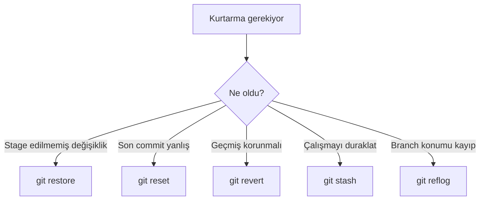

> **Gezinme:** [Önceki: Bölüm 08](08-git-ic-yapisi.md) | [Yol Haritası](../../ROADMAP.md) | Sonraki: Bölüm 10 yakında
>
> **Seviye:** Orta · **Tahmini Süre:** 80 dakika · **Önkoşullar:** [Bölüm 08: Git'in İç Yapısı](08-git-ic-yapisi.md)

## Öğrenme Hedefleri

- `restore`, `reset` ve `revert` arasındaki farkı açıklamak;
- kötü commit veya yanlış düzenlemeden güvenli biçimde kurtulmak;
- tamamlanmamış işi `stash` ile geçici saklamak;
- `reflog` ve `log` ile yakın geçmişi incelemek;
- tek bir commiti `cherry-pick` ile seçerek uygulamak.

## Giriş

Deneyimli Git kullanıcıları da hata yapar; fark, hatadan dönmek için doğru aracı seçmeleridir. Hatanın çalışma dosyasında mı, yerel committe mi, yoksa paylaşılmış geçmişte mi olduğuna göre yöntem değişir.

## Görsel Öğrenme



_Şekil 1. Hatanın türü uygun kurtarma aracını belirler._

## Kuram

- `git restore` çalışma dosyasını veya index'i eski duruma getirir.
- `git reset` yerel bir işaretçiyi taşır ve staging durumunu değiştirebilir.
- `git revert` geçmişi silmeden ters yönde yeni commit oluşturur.

```bash
git restore README.md
git reset HEAD~1
git revert HEAD
```

Paylaşılmış geçmişi değiştirmeden önce mutlaka ekip kuralını ve commitin durumunu kontrol edin.

### Stash kullanmak

```bash
git stash push -m "Pause before review"
git stash list
git stash pop
```

`stash`, kısa süreli duraklama içindir; uzun süreli arşiv değildir.

### Reflog ile kurtarmak

```bash
git reflog
git show HEAD@{1}
git branch recovery HEAD@{1}
```

Reflog, `HEAD` ve branch işaretçilerinin yerel hareketlerini gösterir.

### Cherry-pick

```bash
git cherry-pick <commit-id>
```

Tek bir değişikliği mevcut branche almak için kullanılır. Çatışmaları ve değişikliğin bağlama uygunluğunu kontrol edin.

## Uygulamalı Örnekler

Bir deneme branchinde yanlış commit oluşturun. Paylaşılmış geçmişte `revert`, yalnızca yerel düzeltmede uygun koşullarda `reset` kullanın. Tamamlanmamış çalışmayı stashleyip geri alın ve reflog ile önceki konumu bulun.

## En İyi Uygulamalar

- Yıkıcı komutlardan önce `git status` ve `git log` çalıştırın.
- Paylaşılmış geçmişi gelişigüzel yeniden yazmayın.
- Kurtarma komutlarını önce alıştırma deposunda deneyin.
- Onarım sonrasında diff ve testleri kontrol edin.

## Yaygın Hatalar

- `reset --hard` komutunu yedeksiz kullanmak;
- `revert` ile `reset`i aynı sanmak;
- stashleri uzun süre kontrol etmeden bırakmak;
- reflog'u uzak depo geçmişiyle karıştırmak.

## Alıştırmalar ve Çözümler

Yanlış commit, stashlenmiş çalışma ve kayıp branch konumu senaryolarını deneyin.

**Çözüm:** Paylaşılmış hata için `revert`, geçici çalışma için `stash`, kayıp yerel konum için `reflog` kullanılır. Her işlemden önce durum kontrol edilir.

## Özet

`restore` çalışma dosyalarını, `reset` yerel durumu, `revert` ise geçmişi koruyan ters commitleri yönetir. `stash`, `reflog` ve `cherry-pick` günlük kurtarma ve seçici taşıma işlemlerini destekler.

## Sonraki Bölüm

Bölüm 10, yerel Git çalışmasını GitHub işbirliğiyle birleştirir.

### İlgili İçerik

- Alıştırma: [Kötü Committen Kurtulma](../../exercises/tr/09-kotu-committen-kurtar.md)
- Laboratuvar: [Git ile Kurtarma ve Hata Ayıklama](../../labs/tr/09-git-ile-kurtarma-ve-hata-ayiklama.md)
- Quiz: [İleri Git Teknikleri Quiz'i](../../quizzes/tr/09-ileri-git-teknikleri-quiz.md)
