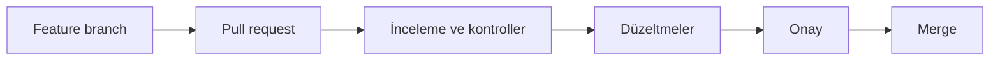

> **Gezinme:** [Önceki: Bölüm 11](11-klon-fork-ve-remote.md) | [Yol Haritası](../../ROADMAP.md) | Sonraki: Bölüm 13 yakında
>
> **Seviye:** Başlangıç · **Önkoşullar:** [Bölüm 11: Klon, Fork ve Remote](11-klon-fork-ve-remote.md)

## Öğrenme Hedefleri

- pull requesti değişiklik önerisi olarak açıklamak;
- base ve head branchleri ayırt etmek;
- anlaşılır PR açıklaması yazmak;
- inceleme yorumlarını ve durum kontrollerini değerlendirmek;
- merge kararını gerekçelendirmek.

## Giriş

Pull request, geliştirme çalışmasını inceleme sürecine bağlar. Feature branch hedef branche karşı önerilir. Ekip diff'i, testleri ve açıklamayı inceler; onaydan sonra değişiklik birleştirilir.

Head branch önerilen çalışmayı, base branch hedefi temsil eder. İyi PR; bağlamı, kapsamı, testleri ve sınırlamaları açıklar.

## En İyi Uygulamalar

- PR'leri küçük ve odaklı tutun.
- Sorun, çözüm ve testleri açıklayın.
- Yorumları somut ve saygılı yazın.
- Merge öncesinde kontrolleri ve çatışmaları inceleyin.

## Yaygın Hatalar

Bağlamsız PR açmak, base ve head branchleri ters seçmek, review yorumlarını yok saymak ve tamamlanmamış işi hazır göstermekten kaçının.

## Özet

Pull requestler değişiklikleri görünür, incelenebilir ve kontrollü hale getirir. Base, head, diff, review ve kontroller işbirliği akışının temelidir.

## Sonraki Bölüm

Bölüm 13, planlama ve durum takibi için GitHub Projects'i tanıtır.

### İlgili İçerik

- Alıştırma: [Pull Request Akışını İnceleme](../../exercises/tr/12-pull-request-isaklagi-incele.md)
- Laboratuvar: [Pull Request Oluşturma ve Birleştirme](../../labs/tr/12-pull-request-olustur-ve-birles.md)
- Quiz: [Pull Requestler Quiz'i](../../quizzes/tr/12-pull-requestler-quiz.md)
