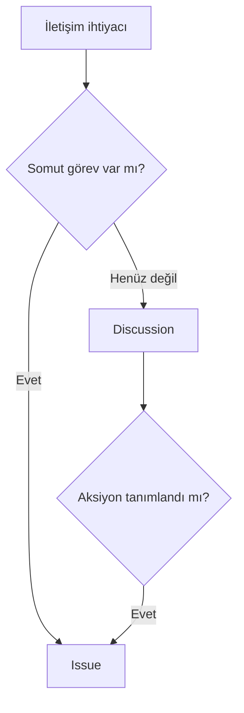

> **Gezinme:** [Önceki: Bölüm 13](13-github-projeleri.md) | [Yol Haritası](../../ROADMAP.md) | Sonraki: Bölüm 15 yakında

## Öğrenme Hedefleri

- issue ve discussion farkını açıklamak;
- anlaşılır hata kaydı yazmak;
- label, assignee ve milestone kullanmak;
- bir tartışmanın ne zaman issue'ya dönüşeceğini seçmek;
- iletişimi Project ve PR ile ilişkilendirmek.

## Giriş

Issue, somut bir görev, hata veya geliştirmeyi takip eder. Discussion ise açık sorular, fikirler, duyurular ve topluluk bilgisini paylaşmak içindir. Seçim, beklenen sonuca göre yapılır.



## Kuram

İyi bir issue; net başlık, bağlam, yeniden üretme adımları, beklenen ve gerçek davranış ile tamamlanma ölçütleri içerir. Label sınıflandırır, assignee sorumluluğu ve milestone büyük hedefi gösterir.

Issue açmadan önce tekrar kayıtları arayın. Gizli veya güvenlik hassas bilgileri herkese açık issue içine yazmayın.

## Uygulamalı Örnek

```text
Başlık: Geçerli bilgilerden sonra giriş düğmesi devre dışı kalıyor
Beklenen: Düğme etkinleşir.
Gerçek: Düğme devre dışı kalır.
Adımlar: Sayfayı aç, bilgileri gir, düğmeyi kontrol et.
```

Belirsiz bir mimari fikri önce discussion içinde tartışmak daha uygundur.

## En İyi Uygulamalar

Issue'ları tek sonuca odaklayın, adımları açık yazın, durum ve sorumluyu güncelleyin, görev netleşince discussionı issue'ya dönüştürün.

## Özet

Issue iş takibi, discussion ise açık iletişim içindir. Açık metin ve doğru metadata her iki aracı da değerli kılar.

## Sonraki Bölüm

Bölüm 15 tag, release note ve yayınlanan sürümleri açıklar.

### İlgili İçerik

- Alıştırma: [Issue ve Discussion Sınıflandırma](../../exercises/tr/14-issue-tartismalari-siniflandir.md)
- Laboratuvar: [GitHub Issue Oluşturma ve Düzenleme](../../labs/tr/14-github-issue-olustur-duzenle.md)
- Quiz: [Issue ve Tartışmalar Quiz'i](../../quizzes/tr/14-issue-ve-tartismalar-quiz.md)
