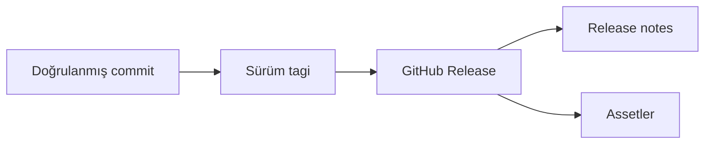

> **Gezinme:** [Önceki: Bölüm 14](14-issue-ve-tartismalar.md) | [Yol Haritası](../../ROADMAP.md) | Sonraki: Bölüm 16 yakında

## Öğrenme Hedefleri

- commit, tag ve GitHub Release ilişkisini açıklamak;
- sürüm tagi oluşturmak;
- anlaşılır release note yazmak;
- draft, prerelease ve stable sürümü ayırt etmek;
- asset ve checksum kavramlarını anlamak.

## Giriş

Tag belirli bir commiti gösterir. GitHub Release bu tagi kullanıcıya açıklayan notlar ve indirilebilir dosyalarla tamamlar. Böylece hangi sürümün önerildiği ve nelerin değiştiği anlaşılır.



## Kuram

```bash
git switch main
git pull origin main
git tag -a v1.2.0 -m "Release version 1.2.0"
git push origin v1.2.0
```

Semantic Versioning `MAJOR.MINOR.PATCH` yapısını kullanır. Uyumsuz değişiklik MAJOR, uyumlu yeni özellik MINOR, geriye dönük uyumlu hata düzeltmesi PATCH artırır.

Release notes; öne çıkan özellikleri, düzeltmeleri, breaking change bilgilerini, migration adımlarını ve sınırlamaları anlatmalıdır. Draft hazırlık, prerelease test, stable normal kullanım sinyalidir.

## Uygulamalı Örnek

```powershell
Get-FileHash .\project-v1.2.0.zip -Algorithm SHA256
```

Checksum, indirilen dosyanın yayınlanan dosyayla aynı olup olmadığını kontrol etmeye yardım eder.

## En İyi Uygulamalar

Sadece test edilmiş commitleri yayınlayın, annotated tag kullanın, breaking changeleri açıkça yazın ve assetleri yayınlamadan önce kontrol edin.

## Özet

Release, kararlı Git durumunu kullanıcıya yönelik açıklama ve dağıtım dosyalarıyla birleştirir. Tag, note ve asset aynı sürümle uyumlu olmalıdır.

## Sonraki Bölüm

Bölüm 16 GitHub Security ve güvenli depo uygulamalarını ele alır.

### İlgili İçerik

- Alıştırma: [GitHub Sürümü Hazırlama](../../exercises/tr/15-github-surumu-hazirla.md)
- Laboratuvar: [Tag ile Sürüm Yayınlama](../../labs/tr/15-etiket-surumu-yayinla.md)
- Quiz: [GitHub Sürümleri Quiz'i](../../quizzes/tr/15-github-surumleri-quiz.md)
