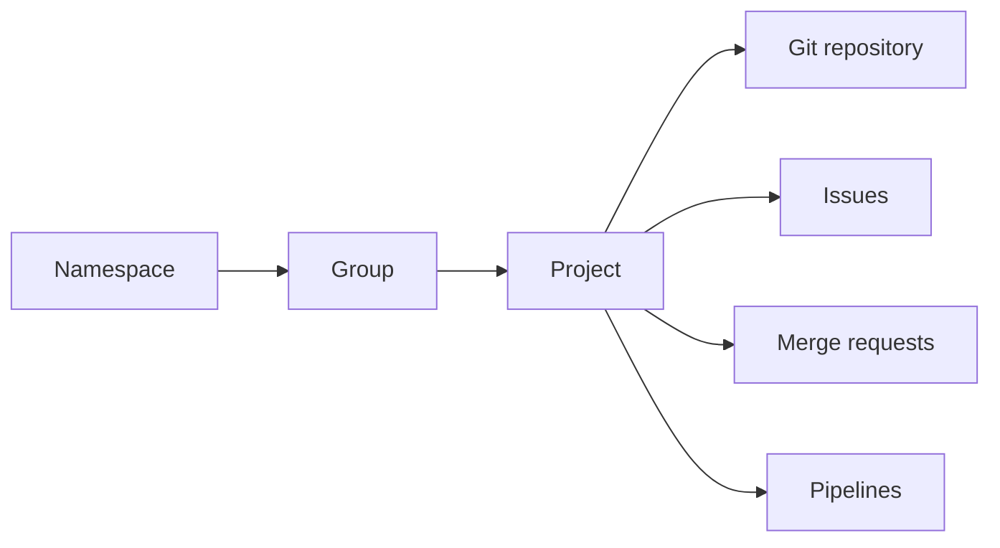

> **Gezinme:** [Önceki: Bölüm 16](16-github-guvenligi.md) | [Yol Haritası](../../ROADMAP.md) | Sonraki: Bölüm 18 yakında

## Öğrenme Hedefleri

- GitLab'ın kaynak kod, iş birliği ve otomasyon platformu olarak rolünü açıklamak;
- namespace, group, project ve repository kavramlarını ayırt etmek;
- görünürlük, üyeler ve rollerin erişimi nasıl etkilediğini açıklamak;
- issue, merge request ve pipeline'ın değişiklik akışındaki yerini tanımlamak.

## Giriş

GitLab, Git depoları etrafında kurulmuş bir DevOps platformudur. Ekipler burada işi planlayabilir, değişiklikleri inceleyebilir ve test gibi tekrarlanan kontrolleri otomatikleştirebilir. Git sürüm kontrolünü sağlar; GitLab ise ekip çalışması için ortak ortamı sunar.

## Görsel Öğrenme



_Şekil 1. GitLab projesi, Git deposunu iş birliği ve otomasyon araçlarıyla birleştirir._

## Neden Önemli?

GitLab; işin neden gerektiğini, kimlerin değişikliği inceleyeceğini ve otomatik kontrollerin başarılı olup olmadığını aynı yerde görünür kılar. Böylece ekip, kodu ve teslim sürecini birbirinden kopuk araçlar olarak yönetmez.

## Temel Terimler

| Terim         | Tanım                                                                                |
| ------------- | ------------------------------------------------------------------------------------ |
| Namespace     | GitLab'da kullanıcıları, grupları ve projeleri düzenleyen yol.                       |
| Group         | İlişkili projeler ve üyeler için kapsayıcı.                                          |
| Project       | Genellikle bir Git deposu ile planlama ve teslim özelliklerini içeren çalışma alanı. |
| Repository    | Projenin dosyaları, commit geçmişi, branchleri ve tagleri.                           |
| Role          | Bir üyenin yapabileceği işlemleri belirleyen yetki seviyesi.                         |
| Issue         | Takip edilen iş, hata, soru veya iyileştirme kaydı.                                  |
| Merge request | Bir source branchteki değişiklikleri target branche birleştirme önerisi.             |
| Pipeline      | Test, build veya teslim için otomatik job dizisi.                                    |

## Kuram

### Namespace, Group ve Project

`acme/platform/storefront` yolu, `acme` namespace'i içindeki `platform` grubunda bulunan `storefront` projesini ifade eder. Gruplar ilişkili projeleri ve ekip üyeliklerini bir araya getirir. Alt gruplar, büyük yapılarda sahipliği anlaşılır tutar.

### Görünürlük ve Roller

Görünürlük, projenin kimler tarafından bulunabileceğini veya okunabileceğini belirler. Roller ise yetkili bir üyenin hangi işlemleri yapabileceğini belirler. Guest, Reporter, Developer, Maintainer ve Owner gibi roller bulunur; ayrıntılı yetkiler kurulum ve yapılandırmaya göre değişebilir.

En az ayrıcalık ilkesini uygulayın: Bir kişiye görevi için gereken en düşük yetkiyi verin. Branch ve merge request oluşturabilen bir katkıcıya proje ayarlarını yönetme izni vermek gerekmez.

### Issue, Merge Request ve Pipeline

Issue; problemi, bağlamı ve beklenen sonucu kaydeder. Merge request; uygulanmış değişikliği diff, açıklama, tartışma, onay ve pipeline sonucu ile incelemeye açar.

Pipeline çoğunlukla `.gitlab-ci.yml` içinde tanımlanan tekrarlanabilir joblardan oluşur. Test, biçim kontrolü veya build çalıştırabilir. Yeşil pipeline yararlı bir kanıttır; yine de dikkatli code review yerine geçmez.

## Pratik Örnekler

### Örnek 1: Proje deposunu klonlama

```bash
git clone https://gitlab.com/acme/platform/storefront.git
cd storefront
git remote -v
```

Bu komutlar depoyu yerelde açar ve `origin` remote'unun adresini doğrular.

### Örnek 2: İncelemeye değişiklik gönderme

```bash
git switch -c docs/kurulum-komutu
git add README.md
git commit -m "docs: kurulum komutunu açıkla"
git push -u origin docs/kurulum-komutu
```

Push işleminden sonra doğru target branch için merge request açın. Açıklamada bağlamı, değişikliği ve doğrulama yöntemini yazın.

### Örnek 3: Başarısız pipeline

Bir job başarısız olursa önce çıktısını okuyun. Sorunu aynı source branchte düzeltin, yerelde kontrol edin ve yeni commit'i push edin. Merge request ile pipeline otomatik güncellenir.

## Kendin Dene

1. Görüntüleyebildiğin bir GitLab projesi aç.
2. Proje yolunu, varsayılan branchi, Issues, Merge requests ve CI/CD alanlarını bul.
3. Bu alanların ekip akışına katkısını birer cümleyle açıkla.

## En İyi Uygulamalar

- Kalıcı ekip üyelikleri ve ilişkili projeler için group kullanın.
- Issue ve merge requestleri küçük ve tek amaçlı tutun.
- Merge öncesinde pipeline sonuçlarını inceleyin.
- Rol atamalarını düzenli gözden geçirin ve gereksiz Maintainer yetkisi vermeyin.

## Yaygın Hatalar

| Hata                                  | Sonuç                                                    | Önleme                                                       |
| ------------------------------------- | -------------------------------------------------------- | ------------------------------------------------------------ |
| Group ile projecti aynı kavram sanmak | Sahiplik ve erişim karışır.                              | Groupu organizasyon, projecti çalışma alanı olarak kullanın. |
| Her üyeye Maintainer vermek           | Ayarlar ve korunan branchler gereksiz risk altına girer. | En düşük uygun rolü seçin.                                   |
| Başarısız pipelineı görmezden gelmek  | Hata veya kural ihlali target branche gidebilir.         | Job çıktısını okuyun, düzeltin ve yeniden doğrulayın.        |

## Özet

- GitLab, Git hosting'i planlama, inceleme, erişim yönetimi ve otomasyonla birleştirir.
- Namespace, group ve project sahiplik yapısını görünür kılar.
- Issue iş bağlamını, merge request inceleme bağlamını, pipeline ise otomatik geri bildirimi sağlar.

## Sonraki Bölüm

Bölüm 18; groupları, projeleri, üyeleri ve izinleri daha ayrıntılı ele alır.

### İlgili İçerik

- Önceki bölüm: [GitHub Güvenliği](16-github-guvenligi.md)
- Alıştırma: [GitLab Proje Temellerini Keşfet](../../exercises/tr/17-gitlab-proje-temellerini-kesfet.md)
- Laboratuvar: [GitLab Değişikliği Oluştur ve İncele](../../labs/tr/17-gitlab-degisikligi-olustur-ve-incele.md)
- Quiz: [GitLab Temelleri Quiz'i](../../quizzes/tr/17-gitlab-temelleri-quiz.md)
