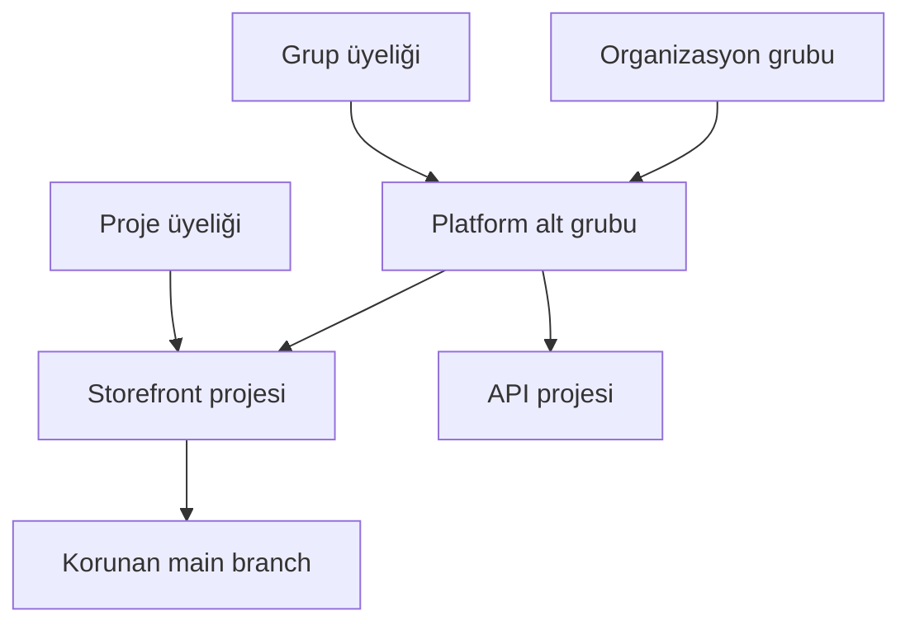

> **Gezinme:** [Önceki: Bölüm 17](17-gitlab-temelleri.md) | [Alıştırma](../../exercises/tr/18-gitlab-proje-erisimini-planla.md) | [Laboratuvar](../../labs/tr/18-gitlab-proje-erisimini-yapilandir.md) | [Quiz](../../quizzes/tr/18-gitlab-gruplar-projeler-uyeler-ve-izinler-quiz.md) | [Yol Haritası](../../ROADMAP.md)

## Öğrenme Hedefleri

- ilişkili işleri group, alt group ve projectlerle düzenlemek;
- görünürlük, üyelik ve rol tabanlı izinleri ayırt etmek;
- en az ayrıcalık, erişim gözden geçirmesi ve korunan branch kurallarını uygulamak.

## Giriş

GitLab erişim tasarımı yapıyla başlar. Grouplar ilişkili projeleri toplar, alt grouplar sahiplik sınırlarını yansıtır ve projectler repository ile teslim çalışmalarını içerir. Açık bir yapı, herkese yalnızca ihtiyacı olan erişimi vermeyi kolaylaştırır.

## Görsel Öğrenme



_Şekil 1. Grup üyeliği projelere erişim sağlayabilir; branch koruması ek bir kontroldür._

## Temel Terimler

| Terim           | Tanım                                                              |
| --------------- | ------------------------------------------------------------------ |
| Group           | İlişkili projeler ve ortak üyelikler için kapsayıcı.               |
| Alt group       | Daha ayrıntılı yapı için başka bir grubun içindeki grup.           |
| Görünürlük      | Bir group veya projecti kimlerin bulabileceği ya da okuyabileceği. |
| Üyelik          | Kullanıcıya group veya project için verilen erişim ilişkisi.       |
| Rol             | Üyenin yapabildiği işlemler; örneğin Developer veya Maintainer.    |
| En az ayrıcalık | Bir görev için gereken en düşük yetkiyi vermek.                    |
| Korunan branch  | Push, merge veya onayı sınırlayan kurallı branch.                  |

## Kuram

### Yapı ve Görünürlük

Kalıcı ekip veya ürün alanı için group, daha küçük sahiplik sınırı için alt group kullanın. Ayrı repository veya teslim birimleri için project oluşturun. Public, internal ve private görünürlük keşfetme ve okumayı kontrol eder; anlamları GitLab kurulumuna göre değişebilir.

### Üyelikler ve Roller

Group üyeliği, birkaç projectte benzer erişime ihtiyacı olan kişiler için uygundur. Project üyeliği dar istisnalar için daha kesindir. Guest, Reporter, Developer, Maintainer ve Owner gibi roller farklı yetkiler sağlar. Rol vermeden önce kurulumdaki güncel izinleri kontrol edin.

### En Az Ayrıcalık ve Erişim Gözden Geçirmesi

Belgelenmiş görev için en düşük rolle başlayın. Geçici erişimi iş bittiğinde kaldırın; doğrudan project üyelerini, kalıtımlı group üyelerini, servis hesaplarını ve dış kullanıcıları düzenli inceleyin. Her incelemede erişim amacının ve rolün hâlâ geçerli olup olmadığını sorun.

### Korunan Branchler

Normal değişikliklerin incelenebilir merge requestlerle ulaşması için varsayılan branchi koruyun. Kimlerin push, merge veya onay yapabileceğini ekip kuralına göre belirleyin. Koruma, rolleri tamamlar: Developer katkı yapabilir ancak `main` kontrollerini atlayamaz.

## Pratik Örnekler

### Örnek 1: Hiyerarşi tasarlama

```text
acme
└── platform
    ├── storefront
    └── payments
```

`platform` alt grubu ekip erişimini paylaşabilir. Her project yine kendi görünürlüğüne ve branch kurallarına sahip olabilir.

### Örnek 2: Göreve göre erişim

| Kişi                    | İhtiyaç                 | Uygun karar                        |
| ----------------------- | ----------------------- | ---------------------------------- |
| Dokümantasyon katkıcısı | Branch ve merge request | En düşük uygun rol                 |
| Sürüm sorumlusu         | Merge kuralını yönetmek | Yalnızca sorumlu alanda Maintainer |
| Eski yüklenici          | Güncel görev yok        | Üyeliği kaldırmak                  |

## Kendin Dene

1. En az iki ilişkili project içeren bir group seç.
2. İzin varsa bir projectin doğrudan ve kalıtımlı üyelerini listele.
3. Varsayılan branchi bul ve kimlerin push ya da merge yapabildiğini açıkla.

## En İyi Uygulamalar

- Kalıcı sahipliği önce group ve alt grouplarla modelleyin.
- Belgelenmiş görev için en düşük rolü verin.
- Erişimi düzenli olarak ve ekip ya da tedarikçi değişiminde inceleyin.
- Önemli branchleri koruyun ve merge request kullanın.

## Yaygın Hatalar

| Hata                                      | Sonuç                                                   | Önleme                                         |
| ----------------------------------------- | ------------------------------------------------------- | ---------------------------------------------- |
| Her katkıcıya Maintainer vermek           | Ayarlar ve önemli branchler gereksiz risk altına girer. | Yönetim gerekmiyorsa daha düşük rol seçin.     |
| Kalıtımlı üyeliği unutmak                 | Erişim üst gruptan devam edebilir.                      | Group ve project üyeliğini birlikte inceleyin. |
| `main` için doğrudan pushlara izin vermek | İnceleme ve kontroller atlanabilir.                     | Branchi koruyun ve merge request kullanın.     |

## Özet

- Grouplar ve alt grouplar sahipliği gösterir ve ortak erişimi kolaylaştırır.
- Görünürlük, üyelik, rol ve branch koruması ayrı kontrollerdir.
- En az ayrıcalık ve düzenli inceleme erişimi gerçek işle uyumlu tutar.

### İlgili İçerik

- Önceki bölüm: [GitLab Temelleri](17-gitlab-temelleri.md)
- Alıştırma: [GitLab Proje Erişimini Planla](../../exercises/tr/18-gitlab-proje-erisimini-planla.md)
- Laboratuvar: [GitLab Proje Erişimini Yapılandır](../../labs/tr/18-gitlab-proje-erisimini-yapilandir.md)
- Quiz: [GitLab Gruplar, Projeler, Üyeler ve İzinler Quiz'i](../../quizzes/tr/18-gitlab-gruplar-projeler-uyeler-ve-izinler-quiz.md)
- [Yol Haritası](../../ROADMAP.md)
