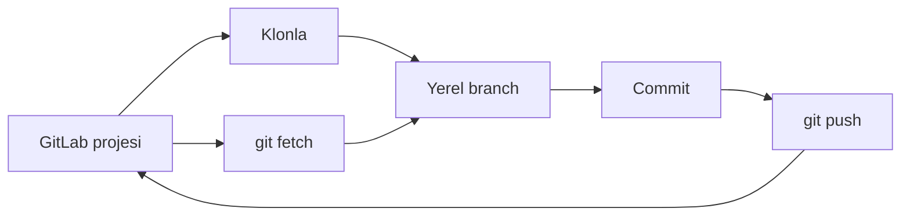

> **Gezinme:** [Alıştırma](../../exercises/tr/19-gitlab-remoteunu-incele.md) | [Laboratuvar](../../labs/tr/19-gitlab-projesini-klonla-katkida-bulun-ve-esitle.md) | [Quiz](../../quizzes/tr/19-gitlab-depo-erisimi-klonlama-ve-remote-is-akislari-quiz.md) | [Yol Haritası](../../ROADMAP.md)

## GitLab Depo Erişimi, Klonlama ve Remote İş Akışları

> **Seviye:** Başlangıç | **Tahmini Süre:** 60 dk. | **Önceki konu:** Bölüm 18, Gruplar, Projeler, Üyeler ve İzinler

## Öğrenme Hedefleri

- izinli proje erişimini doğruladıktan sonra depo URL'si seçmek;
- HTTPS ve SSH'yi kimlik bilgisi yönergesi vermeden Git taşıma seçenekleri olarak açıklamak;
- projeyi klonlamak, `origin`i incelemek ve `fetch`, `pull`, `push` farkını açıklamak;
- varsayılan branch ve etkinse fork iş akışını tanımak.

## Giriş

GitLab, deponun ortak kopyasını barındırır; Git yerel kopyayla çalışır. Güvenli akış, proje yolunu, görünürlüğü ve rolünü kontrol ederek başlar. Onaylanmış klon URL'sini GitLab'ın **Code** alanından alırsın; kuruluşunun onayladığı erişim yöntemi kimlik doğrulamayı yönetir.

## Temel Terimler

| Terim             | Tanım                                                        |
| ----------------- | ------------------------------------------------------------ |
| Klonlama          | Remote deponun geçmişiyle birlikte yerel kopyası.            |
| Remote            | Yerel depo ile başka depo arasındaki adlandırılmış bağlantı. |
| `origin`          | `git clone` tarafından oluşturulan remote için yaygın ad.    |
| Varsayılan branch | Projenin ana entegrasyon branchi.                            |
| Fork              | Bazı katkı modellerinde kullanılan ayrı sunucu kopyası.      |

## Kuram

### HTTPS ve SSH

HTTPS ve SSH, Git'in GitLab ile iletişim kurmak için kullanabildiği taşıma protokolleridir. Bir projenin **Code** sayfası iki URL türünü de sunabilir. Yalnızca kuruluşunun onayladığı türü seç. Parola, erişim belirteci, özel anahtar veya başka sırları komutlara, commitlere ya da dokümantasyona koyma. Erişim başarısız olursa tahminde bulunmak yerine onaylı destek sürecini kullan.

### Klonlama, Remoteler ve Eşitleme

```bash
git clone https://gitlab.example.com/team/demo-app.git
cd demo-app
git remote -v
git branch --show-current
```

Klonlama genellikle `origin`i ekler. `git fetch origin`, çalışma dosyalarını değiştirmeden remote bilgisini indirir. `git pull --ff-only`, değişiklikleri alır ve yalnızca güvenli fast-forward entegrasyonu yapar. `git push origin feature/readme-notu`, yetkin varsa belirtilen yerel branchi yayımlar.



### Varsayılan Branch ve Forklar

Varsayılan branchin `main` olduğunu varsayma. Hedef seçmeden önce GitLab'da kontrol et. Korunan varsayılan branchler çoğu zaman doğrudan push yerine merge request ister.

Forklar etkinse katkıcı kendi forkunu klonlayabilir, özgün projeyi `upstream` olarak ekleyebilir, `upstream`den fetch yapabilir ve feature branchini kendi forkuna push edebilir. Merge request daha sonra özgün projeye önerilir. Forkların kullanılabilirliği ve kuralları projeye bağlıdır.

## Pratik Örnekler

### Örnek 1: Değişiklikten önce remote inceleme

```bash
git remote -v
git fetch origin
git branch -r
```

Önce `origin`in beklenen projeye ait olduğunu doğrula. Fetch, entegrasyon kararı vermeden önce remote değişikliklerini görmenin düşük riskli yoludur.

### Örnek 2: Feature branchi güncelleme ve yayımlama

```bash
git switch feature/readme-notu
git pull --ff-only
git push origin feature/readme-notu
```

`pull --ff-only` komutunu yalnızca güncellemek istediğin branchte çalıştır. Fast-forward başarısız olursa zorla birleştirmek yerine dur ve geçmişi incele.

## En İyi Uygulamalar

- Clone, fetch veya push öncesinde proje yolunu ve remote URL'sini doğrula.
- Entegrasyon kararından önce fetch yap; merge istemiyorsan `--ff-only` kullan.
- Proje kuralları aksini belirtmedikçe varsayılan branchi korumalı kabul et.
- Fork remote'larını açık adlandır: fork için `origin`, özgün proje için `upstream`.
- Sadece onaylı erişim yöntemlerini kullan ve erişim sorunlarını doğru kanaldan bildir.

## Yaygın Hatalar

| Hata                                  | Sonuç                                     | Önleme                                         |
| ------------------------------------- | ----------------------------------------- | ---------------------------------------------- |
| Push öncesi `origin`i kontrol etmemek | Branch yanlış projeye gönderilebilir.     | Önce `git remote -v` çalıştır.                 |
| `fetch` ve `pull`u aynı sanmak        | `pull` mevcut branchi değiştirebilir.     | Önce incele, sonra bilinçli olarak entegre et. |
| Her projede fork olduğunu varsaymak   | Forklar devre dışı veya kurallı olabilir. | Projenin katkı kurallarını oku.                |

## Özet

- Erişim, yetki ve onaylı klon URL'si ile başlar.
- HTTPS ve SSH taşıma seçeneğidir; sırların yeri değildir.
- `fetch` inceler, `pull` entegre eder, `push` branchi yayımlar.
- Varsayılan branch ve forklar projenin ayarlarına uyar.

## Sonraki Adım

[Alıştırmayı](../../exercises/tr/19-gitlab-remoteunu-incele.md) tamamla, ardından tam akışı [laboratuvarda](../../labs/tr/19-gitlab-projesini-klonla-katkida-bulun-ve-esitle.md) uygula.
