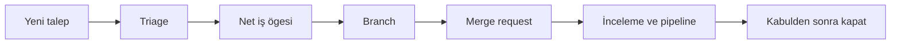

> **Gezinme:** [Yol Haritası](../../ROADMAP.md)

## Öğrenme Hedefleri

- başlık, açıklama ve kabul kriterleri olan work item veya issue yazmak;
- label, assignee, milestone ve desteklenen planlama görünümlerini kullanmak;
- gelen işleri triage edip önceliklendirmek;
- işi branch ve merge request ile ilişkilendirmek.

## Giriş

GitLab work item ve issue'ları bir talebi ortak, takip edilebilir işe dönüştürür. Adlar ve planlama görünümleri GitLab sürümüne ve yapılandırmasına göre değişebilir. Temel yaklaşım aynıdır: sonucu tanımla, önceliklendir, sorumluluğu belirle ve teslim kanıtını bağla.

## Temel Terimler

| Terim                     | Tanım                                                                 |
| ------------------------- | --------------------------------------------------------------------- |
| Work item / issue         | Görev, hata, istek veya iyileştirme kaydı.                            |
| Kabul kriterleri          | İşin tamamlandığını gösteren gözlemlenebilir koşullar.                |
| Label                     | `bug` veya `priority::high` gibi tekrar kullanılabilir sınıflandırma. |
| Assignee                  | İşin ilerletilmesinden şu anda sorumlu kişi.                          |
| Milestone                 | Bir zaman aralığı veya hedef için ilişkili işlerin kümesi.            |
| Board / planlama görünümü | İşi durum, label veya başka alanlara göre gösteren görünüm.           |

## Kuram

### Sonuçla başlamak

İyi bir başlık yalnızca etkinliği değil, sonucu söyler. `Login'i iyileştir` belirsizdir; `Geçersiz giriş bilgileri için net mesaj göster` doğrulanabilir. Açıklama bağlamı, hedefi, kapsam dışını ve bağlantıları içerir. Kabul kriterleri, geliştirme başlamadan bitmiş sayılacak davranışı tanımlar.

### Triage kuyruğu güvenilir yapar

Triage sırasında ekip gelen işi inceler: Anlaşılır mı? Tekrar mı? Hangi label, öncelik ve sonraki adım gerekli? Öncelik, talebi kimin en son ilettiğine göre değil; etki, aciliyet, risk ve emeğe göre verilmelidir.

### Desteklenen özelliklerle planlama

Label ve milestone'lar yaygın olarak kullanılabilir. Board veya diğer planlama görünümleri destekleniyorsa işi durum, öncelik veya iterasyona göre görünür kılar. Yalnızca ekibin güncel tutacağı alanları yapılandırın.

### Planı teslimle bağlamak

`123-gecersiz-giris-mesaji` gibi odaklı bir branch oluşturun ve merge request içinde work item'a referans verin. GitLab desteklenen kapatma referanslarını tanıyabilir; ancak otomatik kapatmaya güvenmeden önce hedef branch ve proje kurallarını doğrulayın.



## Pratik Örnek

```text
Başlık: Geçersiz giriş bilgileri için net mesaj göster
Labels: type::bug, area::authentication, priority::high
Milestone: Eylül güvenilirlik
Kabul kriterleri:
- Geçersiz bilgiler anlaşılır ve nötr bir mesaj gösterir.
- Mesaj bir hesabın var olup olmadığını açıklamaz.
- Otomatik testler geçersiz bilgi yolunu kapsar.
```

## En İyi Uygulamalar

- Kriterleri tahmin değil, gözlemlenebilir sonuç olarak yazın.
- Küçük ve ortak bir label sözlüğü kullanın.
- Tek sorumlu atayın; iş birliğini açık tutun.
- Etki veya tarih değiştiğinde önceliği yeniden değerlendirin.
- Work item, branch ve merge request'i bağlayın.

## Yaygın Hatalar

| Hata                                   | Sonuç                   | Önleme                                 |
| -------------------------------------- | ----------------------- | -------------------------------------- |
| Başlık yalnızca "Hatayı düzelt" demesi | Backlog taranamaz.      | Beklenen sonucu yazın.                 |
| Kriterin "doğru çalışır" olması        | Tamamlanma öznel kalır. | Davranışı ve kanıtı belirtin.          |
| Her işin acil olması                   | Teslim sırası kaybolur. | Etki ve zaman baskısını karşılaştırın. |

## Özet

- Work item ve issue'lar işe ortak bağlam sağlar.
- Başlık, açıklama ve kriterler sonucu tanımlar.
- Label, assignee, milestone ve görünümler planlamayı düzenler.
- Branch ve merge request, planı uygulamaya bağlar.

## Alıştırma

Üç talebi [ilgili alıştırmada](../../exercises/tr/20-gitlab-is-ogelerini-onceliklendir.md) triage edin.

## Laboratuvar

[İlgili laboratuvarda](../../labs/tr/20-kucuk-bir-gitlab-teslimatini-planla.md) küçük bir teslimatı planlayın.

## Quiz

[Bölüm 20 quiz'i](../../quizzes/tr/20-gitlab-is-ogeleri-issuelar-ve-planlama-quiz.md) ile bilginizi kontrol edin.
