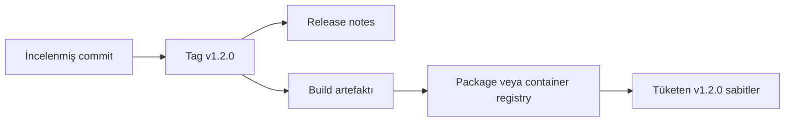

> **Gezinme:** [Alıştırma](../../exercises/tr/22-surumlu-bir-release-planla.md) | [Laboratuvar](../../labs/tr/22-surumlu-package-yayinla-ve-kullan.md) | [Quiz](../../quizzes/tr/22-releaseler-packageler-ve-container-registry-quiz.md) | [Yol Haritası](../../ROADMAP.md)

## Öğrenme Hedefleri

- release'in kullanıcılara neden kararlı bir teslim noktası sunduğunu açıklamak;
- semantik sürümlemenin temellerini uygulamak ve tag ile release'i ayırmak;
- package ve container registry, sahiplik, erişim ve değişmez sürümleri açıklamak;
- gizli bilgi kullanmadan güvenli yayınlama ve tüketme akışını ana hatlarıyla belirtmek.

## Giriş

Bir release, kullanıcıların güvenle kullanabileceği bir sürümü tanımlar. Registry'ler bu sürümün package'lerini veya container image'larını saklar. Birlikte teslimatı izlenebilir, tekrarlanabilir ve geri alınması daha kolay hale getirirler.

## Temel Kavramlar

| Kavram         | Anlamı                                                                   |
| -------------- | ------------------------------------------------------------------------ |
| Semantik sürüm | `MAJOR.MINOR.PATCH`: kırıcı değişiklik, uyumlu özellik, uyumlu düzeltme. |
| Tag            | `v1.2.0` gibi bir commit'i işaretleyen Git referansı.                    |
| Release        | Genellikle bir tag ve release notes ile bağlı yayımlanmış teslim kaydı.  |
| Registry       | Sürümlenmiş package veya container image saklayan hizmet.                |
| Değişmez sürüm | İçeriği sonradan değiştirilmeyen yayımlanmış sürüm.                      |

## Kuram

### Tag ve Release'in Görevleri

Tag kaynak kodun hangi commit olduğunu gösterir. Release ise kullanıcılar için hazır olanı; sürümü, notları, artefaktları ve bilinen sınırları ile açıklar. Kaynak ve teslim kaydını bağlı tutmak için incelenmiş tag'den release oluşturun.

### Semantik Sürümleri Okumak

`2.4.1` içinde `2` kırıcı genel değişikliği, `4` uyumlu yeni özelliği, `1` ise uyumlu düzeltmeyi anlatır. Sürüm numarası emeği değil, uyumluluk beklentisini ifade eder.

### Registry'ler Build Çıktılarını Korur

Package registry kütüphaneleri, container registry ise `registry.example/team/api:1.2.0` gibi image'ları saklayabilir. Yalnızca doğrulamadan sonra yayınlayın. Tüketenler `latest` gibi hareketli etiket yerine sabit bir sürüm kullanmalıdır.

### Sahiplik ve Erişim

Registry ad alanının sahibi proje veya gruptur. Yayınlama iznini yalnızca buna ihtiyacı olan kişilere veya otomasyona, okuma iznini ise tüketenlere verin. CI içinde platformun korumalı değişkenlerini, token'larını veya workload identity'sini kullanın; kimlik bilgilerini kaynakta, release notes'ta veya image katmanlarında tutmayın.

## Temel Akış

1. Değişiklik kapsamını kararlaştırın ve uyumluluğa göre `v1.2.0` seçin.
2. Commit'i test edin, uygun tag'i oluşturun ve kullanıcı odaklı release notes yazın.
3. Yetkili otomasyon ile `1.2.0` sürümünü uygun registry'ye yayınlayın.
4. Tam olarak `1.2.0` tüketin, kaynak veya digest'i doğrulayın ve bağımlılığı kaydedin.

## En İyi Uygulamalar

- Tag, release notes ve registry artefaktını tek bir izlenebilir teslim olarak ele alın.
- Yayımlanmış sürümü değiştirmeyin; düzeltme için yeni patch sürümü yayınlayın.
- Notlarda kullanıcı etkisini, yükseltmeyi, düzeltmeleri ve bilinen sınırları açıklayın.
- Package'leri sürüme, image'ları güvenilir sürüme veya digest'e sabitleyin.
- Ad alanı sahipliğini ve okuma/yayınlama izinlerini düzenli inceleyin.

## Yaygın Hatalar

| Hata                                             | Daha iyi yaklaşım                                |
| ------------------------------------------------ | ------------------------------------------------ |
| Değişen artefakt için `1.2.0` sürümünü kullanmak | `1.2.1` gibi yeni sürüm yayınlamak.              |
| Tag'i tam release iletişimi sanmak               | Kullanıcı odaklı release notes eklemek.          |
| Üretimde `latest` tüketmek                       | Test edilmiş sabit sürüm veya digest belirtmek.  |
| Registry kimlik bilgisini dokümante etmek        | Yetkili CI erişimini depo dışında yapılandırmak. |

## Özet

- Release'ler kullanılabilir sürümü açıklar; tag'ler kaynak commit'i işaretler.
- Semantik sürümler uyumluluk beklentisini ifade eder.
- Registry'ler package ve image'ları kontrollü erişimle dağıtır.
- Değişmez sürümler ve en az yetki tüketimi tekrarlanabilir hale getirir.

## Uygulama

[Alıştırma](../../exercises/tr/22-surumlu-bir-release-planla.md), [laboratuvar](../../labs/tr/22-surumlu-package-yayinla-ve-kullan.md) ve [quiz](../../quizzes/tr/22-releaseler-packageler-ve-container-registry-quiz.md) ile devam edin.
