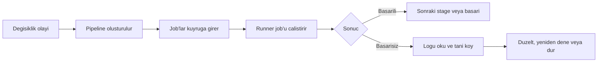

> **Level:** Beginner | **Estimated Time:** 60 min

## Ogrenme Hedefleri

- pipeline, job, stage, runner ve pipeline durumlarini aciklamak;
- yaygin tetikleyicileri ve olusturduklari geri bildirim dongusunu tanimak;
- basarisiz bir job'u inceleyip guvenli yeniden deneme karari vermek.

## Giris

GitLab CI/CD, ekibe bir degisiklik hakkinda hizli kanit saglar. Push veya merge request gibi bir olaydan sonra pipeline tanimli kontrolleri calistirir. Bu bolum calisma modelini aciklar; `.gitlab-ci.yml` yapilandirma ayrintilari sonraki bolumlerdedir.

## Temel Terimler

| Terim                 | Tanim                                                      |
| --------------------- | ---------------------------------------------------------- |
| Pipeline              | Bir degisiklik veya olay icin calisan tum otomasyon.       |
| Job                   | Test ya da kalite kontrolu gibi tek bir odakli is birimi.  |
| Stage                 | Sirali bir job grubu.                                      |
| Runner                | Bir job'u uygun ortamda alan ve calistiran worker.         |
| Geri bildirim dongusu | Degisiklikten sonuca, sonucdan sonraki karara giden dongu. |

## Teori

### Tetikleyiciden sonuca

Proje kurallarina bagli olarak push, merge request, zamanlama veya manuel eylem pipeline baslatabilir. Job'lar runner'larda calisir ve `pending`, `running`, `passed`, `failed`, `canceled`, `skipped` veya `manual` gibi durumlar bildirir. Proje farkli bir davranis tanimlamadiysa basarisiz job pipeline'i basarisiz yapar.



### Stage'ler riski siralar

Ekipler hizli kontrolleri genellikle yavas veya daha riskli kontrollerden once koyar. Bir test stage'i, teslim stage'i devam etmeden once yararli geri bildirim vermelidir. Stage bir koordinasyon siniridir; job'larin ayni surecegi anlamina gelmez.

### Yeniden denemeden once tani koy

Basarisiz job'u acin. Ilk anlamli hatayi, basarisiz komutu ve baglami okuyun. Yalnizca runner kesintisi veya gecici ag hatasi gibi gecici bir neden icin kanit varsa yeniden deneyin. Tekrarlanabilir test, build veya kural hatasini gizlemek yerine duzeltin.

## Pratik Ornek

```text
Push feature/login-message
  -> pipeline baslar
  -> lint job basarili olur
  -> test job basarisiz olur: notr mesaj bekleniyordu
  -> gelistirici davranisi duzeltir ve commit push eder
  -> yeni pipeline guncel kanit saglar
```

Hata tekrarlanabildigi icin yeni pipeline, ayni pipeline'i tekrar tekrar denemekten daha degerlidir.

## En Iyi Uygulamalar

- Pipeline sonucunu commit ve hedef baglamiyla birlikte degerlendirin.
- Yeniden deneme kararindan once job loglarini okuyun.
- Geri bildirimi merge request icinde gorunur tutun.
- Bloke olan veya tekrar tekrar basarisiz olan runner'lari log kanitiyla eskale edin.

## Yaygin Hatalar

| Hata                               | Neden sorun olur                          | Nasil onlenir                               |
| ---------------------------------- | ----------------------------------------- | ------------------------------------------- |
| Her hatayi runner sorunu saymak    | Komut gercek bir kusuru gosterebilir.     | Basarisiz job'u inceleyin.                  |
| Nedensiz yeniden denemek           | Zaman kaybettirir ve kararsizligi gizler. | Yalnizca makul gecici neden varken deneyin. |
| `pending` ve `running` karistirmak | Is henuz baslamamis olabilir.             | Kuyruk ve runner uygunlugunu kontrol edin.  |

## Ozet

- Pipeline, tetiklenen koordineli bir job kumesidir.
- Job'lar runner'larda calisir; stage'ler akisi siralar.
- Durumlar ve loglar geri bildirim dongusu olusturur.
- Gecici hatalari yeniden deneyin; tekrarlanabilir hatalari duzeltin.

## Alistirma

Pipeline sonuclarini [ilgili alistirmada](../../exercises/tr/23-gitlab-pipeline-sonuclarini-tanila.md) siniflandirin.

## Laboratuvar

Guvenli hata yanitini [ilgili laboratuvarda](../../labs/tr/23-gitlab-pipeline-hatasini-incele.md) uygulayin.

## Quiz

Bilginizi [Bolum 23 quizinde](../../quizzes/tr/23-gitlab-cicd-temelleri-quiz.md) kontrol edin.
