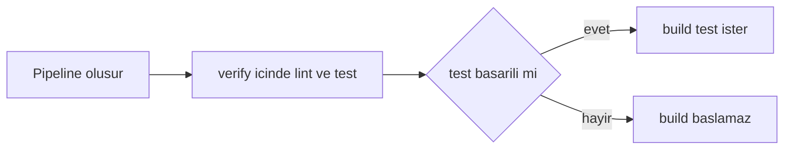

> **Navigation:** [Bolum 23](23-gitlab-cicd-temelleri.md) | [Alistirma](../../exercises/tr/24-bir-gitlab-ci-pipeline-yazin.md) | [Laboratuvar](../../labs/tr/24-bir-gitlab-ci-pipeline-inceleyin.md) | [Quiz](../../quizzes/tr/24-gitlab-ci-yml-pipelines-asamalar-ve-isler-quiz.md) | [Roadmap](../../ROADMAP.md)

> **Level:** Beginner | **Tahmini Sure:** 90 dk | **On Kosul:** [GitLab CI/CD Temelleri](23-gitlab-cicd-temelleri.md)

## Ogrenme Hedefleri

- kucuk ve gecerli bir `.gitlab-ci.yml` dosyasi yazmak ve okumak;
- asamalarin isleri nasil siraladigini ve ayni asamadaki islerin neden paralel calisabildigini aciklamak;
- temel `rules`, `workflow: rules` ve `needs` yapilarini amacli kullanmak;
- gizli bilgi veya dagitim adimi eklemeden pipeline'i dogrulamak ve hata ayiklamak.

## Giris

`.gitlab-ci.yml`, GitLab'in pipeline tarifidir. GitLab pipeline olustururken ilgili commit'teki bu dosyayi okur ve YAML verisinden isler uretir. Dosya, `package.json` gibi dosyalarin yaninda, repository'nin kok dizininde bulunur. Alt klasordeki ayni adli dosya normal pipeline giris noktasi degildir.

## Temel Terimler

| Terim    | Tanim                                                            |
| -------- | ---------------------------------------------------------------- |
| YAML     | Girintilerle map ve liste gosteren metin bicimi.                 |
| Pipeline | Bir commit icin olusturulan tum otomasyon calismasi.             |
| Asama    | Sirali bir is grubu.                                             |
| Is       | Runner tarafindan calistirilan adlandirilmis calisma birimi.     |
| `rules`  | Bir isin pipeline'a eklenip eklenmeyecegini belirleyen kosullar. |
| `needs`  | Is grafigini olusturan acik bagimliliklar.                       |

## YAML Temelleri

YAML yapisini girintilerle gosterir. Map, bir anahtari bir degerle esler; liste ise her oge icin `-` kullanir. Tutarlı bicimde, tercihen iki bosluk kullanin. Tab karakteri gecerli bir girinti degildir.

```yaml
lint:
  stage: verify
  script:
    - npm run lint
    - npm run format:check
```

`lint`, degeri job map'i olan bir anahtardir. `script` bir listedir; bu nedenle her komut `-` ile baslar. Hizali girinti, hangi satirlarin ayni ise ait oldugunu gosterir.

### Yaygin YAML Sozdizimi Hatalari

```yaml
lint:
 stage: verify       # Yanlis: girinti tutarsiz.
	script: npm run lint # Yanlis: tab kullaniliyor.
  script             # Yanlis: iki nokta eksik.
    - npm run lint
```

YAML hatasi, herhangi bir is baslamadan pipeline olusumunu engelleyebilir. Kardes anahtarlari hizalayin, anahtarlardan sonra iki nokta koyun ve `:` gibi anlami belirsizlestirebilecek karakterler iceren degerleri tirnaklayin. YAML dogrulayici sozdizimini kontrol eder; GitLab CI Lint ise GitLab anahtarlarini da kontrol eder.

## Dosyadan Pipeline'a

`stages` belirtilmezse GitLab varsayilan asama sirasini kullanir: `.pre`, `build`, `test`, `deploy`, `.post`. Acik asamalar, amaclanan yasam dongusunu daha iyi belgeler. `stage` anahtari olmayan bir is varsayilan olarak `test` asamasini kullanir.

```yaml
stages:
  - verify
  - build

lint:
  stage: verify
  script:
    - npm run lint
```

Bu yapilandirma iki asama tanimlar. `lint`, `verify` icindedir; `build` icin henuz is yoktur. GitLab, sonraki asamadaki normal isleri baslatmadan once onceki asamadaki calisabilir islerin bitmesini bekler. `verify` icindeki isler runner uygunsa paralel calisabilir. Paralel, bitis sirasi garantili demek degildir.

## Bir Isin Yapisi

```yaml
lint:
  image: node:22-alpine
  stage: verify
  before_script:
    - npm ci
  script:
    - npm run lint
  after_script:
    - echo "Lint isi bitti; son durumu logdan inceleyin."
```

`lint` ismi pipeline ekraninda gorulur. `image`, is icin container imajini secer. `before_script`, burada tekrarlanabilir bagimlilik kurulumu yapar. `script` ana isi icerir. `after_script`, ana komut basarisiz olsa bile calisir; bu yuzden guvenli tani iletileri veya temizlik icin uygundur, hatayi gizlememelidir. `stage` isi akistaki yerine baglar.

## Asamali Node.js Ornegi

En kucuk yararli denetimle baslayin:

```yaml
lint:
  image: node:22-alpine
  script:
    - npm ci
    - npm run lint
```

`stage` olmadigi icin bu is varsayilan `test` asamasindadir. Gecerli olsa da pipeline'in niyetini acikca anlatmaz.

```yaml
stages:
  - verify
  - build

lint:
  image: node:22-alpine
  stage: verify
  before_script:
    - npm ci
  script:
    - npm run lint

test:
  image: node:22-alpine
  stage: verify
  before_script:
    - npm ci
  script:
    - npm test
```

`lint` ve `test` ayni asamada oldugu icin birlikte calisabilir. Her is bagimliliklarini kendi ortamina kurar. Cache kurulumu burada bilincli olarak anlatilmaz; Bolum 25 cache ve artifact konusuna giris yapar.

```yaml
workflow:
  rules:
    - if: '$CI_PIPELINE_SOURCE == "merge_request_event"'
    - if: '$CI_PIPELINE_SOURCE == "push"'
    - when: never

stages:
  - verify
  - build

default:
  image: node:22-alpine
  before_script:
    - npm ci

lint:
  stage: verify
  script:
    - npm run lint

test:
  stage: verify
  script:
    - npm test
  rules:
    - if: '$CI_PIPELINE_SOURCE == "merge_request_event"'
    - if: '$CI_PIPELINE_SOURCE == "push"'

build:
  stage: build
  needs:
    - test
  script:
    - npm run build
  after_script:
    - echo "Build isi tamamlandi; sonucu job logundan inceleyin."
```

`workflow: rules`, GitLab'in hic pipeline olusturup olusturmayacagina karar verir. Ornek, merge request olayi ve push icin izin verir; son `when: never` diger tum kaynaklari reddeder. `if: '$CI_PIPELINE_SOURCE == "merge_request_event"'` bir karsilastirmadir, shell komutu degildir. Job duzeyindeki `rules`, pipeline olustuktan sonra o isin eklenip eklenmeyecegine karar verir.

`default`, imaji ve hazirligi paylastirirken her isin amacini gorunur tutar. `build`, sonraki asamadadir ve ayrica `needs: [test]` bildirir. Bunu `test -> build` kenari gibi dusunun: build, basarili test kaniti olmadan baslayamaz. Daha buyuk grafiklerde `needs`, yalnizca asama engeline guvenmek yerine gercek bagimliliklari acikca anlatir. Sadece grafik ilginç gorunsun diye `needs` eklemeyin.

## Calisma Sirasi, Durumlar ve Loglar



GitLab isleri `pending`, `running`, `passed`, `failed`, `canceled`, `skipped` veya `manual` olarak gosterir. Basarisiz iste ilk basarisiz komutu, hatasini ve yakin baglami bulun. Son kirmizi satir cogunlukla yalnizca ozet niteligindedir. Atlanan bir is, kurallari eslesmedigi icin beklenen bir sonuc olabilir.

## Guvenli Dogrulama ve Hata Ayiklama

1. Yerelde girintiyi, map'leri, listeleri ve iki noktalari kontrol edin.
2. Tum yapilandirmayi ve acilan kurallari GitLab CI Lint ile kontrol edin.
3. Is sirasini dogru kabul etmeden once pipeline grafigini okuyun.
4. Kucuk bir branch veya merge request degisikligiyle zararsiz pipeline calistirin ve loglari inceleyin.
5. Mümkunse belirli komutu yerelde yeniden uretin; nedeni duzeltin ve yeni pipeline olusturun.

Parola, token, ozel URL veya gizli degerleri `.gitlab-ci.yml` ya da job loglarina koymayin. Bu bolum deployment yapilandirmaz. Gecici runner veya ag hatasi kanitlandiginda nedeni not ederek bir kez yeniden deneyin; tekrarlanabilir lint, test veya build hatalarini ise duzeltin.

## En Iyi Uygulamalar

- Isleri odakli tutun: lint, test ve build farkli sorulara cevap verir.
- Akisin anlasilir olmasi icin asamalari acikca tanimlayin.
- Kural ifadelerini tirnaklayin.
- Degisiklikten once grafik ve ilk anlamli hata iletisini okuyun.
- Cache yapilandirmasini Bolum 25'e birakin.

## Yaygin Hatalar

| Hata                                          | Neden sorun olur                          | Daha iyi yaklasim            |
| --------------------------------------------- | ----------------------------------------- | ---------------------------- |
| Tab ve bosluklari karistirmak                 | YAML ayrisamayabilir.                     | Tutarlı bosluk kullanin.     |
| Islerin sirayla calistigini sanmak            | Ayni asamadaki isler paralel calisabilir. | Isleri bagimsiz tasarlayin.  |
| `workflow: rules` ile job `rules` karistirmak | Farkli seviyelerde karar verirler.        | Karari dogru seviyeye koyun. |
| Her hatada yeniden denemek                    | Tekrarlanabilir hata cozulmez.            | Logu okuyup nedeni duzeltin. |

## Ozet

- Repository kokundeki `.gitlab-ci.yml` pipeline'i tanimlar.
- YAML girintisi, map'ler ve listeler yapilandirmanin yapisini belirler.
- Asamalar genel sirayi verir; ayni asamadaki isler paralel calisabilir.
- `rules`, `workflow: rules` ve `needs` karar ve bagimliliklari aciklar.
- Loglar ve CI Lint guvenli, kanita dayali hata ayiklama saglar.

## Uygulama

[Alistirmada](../../exercises/tr/24-bir-gitlab-ci-pipeline-yazin.md) kucuk bir pipeline yazin, [laboratuvarda](../../labs/tr/24-bir-gitlab-ci-pipeline-inceleyin.md) hatali yapilandirmayi inceleyin ve [quizde](../../quizzes/tr/24-gitlab-ci-yml-pipelines-asamalar-ve-isler-quiz.md) bilginizi kontrol edin.
